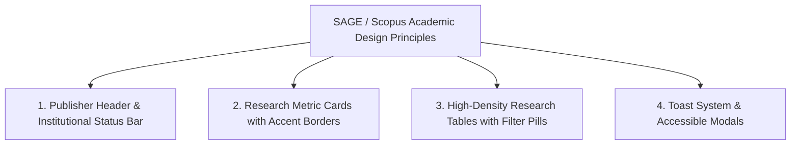

# Implementation Plan: Phase 5 SAGE & Scopus Inspired Academic UI/UX & Accessibility

This document outlines the build plan for **Phase 5: SAGE Publishing & Scopus Inspired Academic UI/UX & Accessibility** for the **Veridica OJS Super Admin Panel**, in accordance with SRS v1.0 (Section 4.1, FR-3.14, NFR-5.5).

---

## 🎨 Academic Inspiration & Design Principles (SAGE & Scopus)

---

## 🛠️ Detailed Technical Scope

### **1. SAGE & Scopus Inspired Academic Header & Top Navigation Bar**
- **Publisher Branding**: Top header with Veridica Academic emblem, institution badge (*Veridica Academic Publishing & Research Oversight Network*), and platform status tag (*Indexed System • Open Access Oversight*).
- **Quick Metric Summary Pill Bar**: Header badges showing total indexed manuscripts, active reviewers, and system health status.

---

### **2. Research Metric Cards with Top Accent Borders (Scopus / Springer Style)**
- **Card Styling**: Clean white cards with top accent borders (`border-t-4 border-[#003366]`), subtle box shadows, uppercase tracking titles, and typography (Inter/Geist pairing).
- **Metrics Covered**:
  - *Total Platform Users* (Author / Reviewer / Editor breakdown)
  - *Manuscript Intake & Published Articles*
  - *Active Peer Review Assignments & Velocity*
  - *Hosted Journals & Indexing Status*
  - *24h Security & Audit Trail Events*

---

### **3. High-Density Research Tables (Scopus Style)**
- **Table Design**:
  - High-density data layout with subtle zebra striping (`bg-slate-50/40`), sticky header row, and hover row highlighting (`hover:bg-blue-50/40`).
  - Styled status pills: `Active` (Green), `Suspended` (Red), `Published` (Blue), `Under Review` (Amber).
  - Search input with filter pill tags (*All Users*, *Active*, *Suspended*, *Logins*, *Admin Actions*).

---

### **4. Toast Notification System & Custom Confirmation Modals**
- **Toast System (`react-hot-toast`)**:
  - Replaces raw browser alerts with smooth, elegant toast notifications for user suspension, reinstatement, MFA 2FA verification, and CSV/PDF export downloads.
- **Academic Confirmation Modals**:
  - Custom styled confirmation modals for account suspension, soft deletion, and 2FA disabling, featuring backdrop blur (`backdrop-blur-xs`), keyboard `Esc` dismiss, and action focus.

---

### **5. Skeleton Loading States & WCAG 2.1 AA Accessibility (NFR-5.5)**
- **Skeleton Component Loaders (`src/components/ui/Skeleton.tsx`)**:
  - Skeleton placeholders for cards, tables, and chart areas during data fetching.
- **Accessibility & Keyboard Navigation**:
  - Minimum 4.5:1 color contrast ratio.
  - Visible focus rings (`focus:ring-2 focus:ring-[#003366] focus:ring-offset-2`) for all keyboard tab focus states.
  - ARIA attributes (`aria-label`, `aria-describedby`, `role="status"`, `role="dialog"`).

---

## 🔍 Verification & Testing Plan

1. **Academic Visual Inspection**: Verify SAGE & Scopus inspired header, top accent cards, high-density research tables, and filter pills.
2. **Toast & Modal Testing**: Verify toast notifications and custom modal dialogs when suspending/reinstating accounts or triggering exports.
3. **Skeleton & Keyboard Navigation Audit**: Verify skeleton loaders and full keyboard navigation (`Tab`, `Enter`, `Esc`).
4. **Live Chrome Browser Verification**: Launch browser subagent to test and record the new academic UI.
