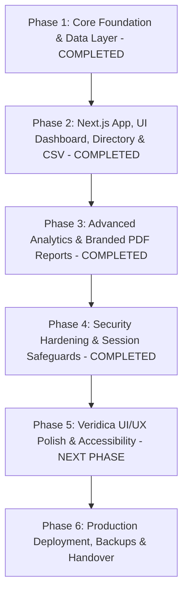

# Implementation Plan: Veridica OJS Super Admin Panel (Multi-Phase Roadmap)

This document details all project phases for the **Veridica OJS Super Admin Oversight Panel** in accordance with SRS v1.0.

> [!NOTE]
> **Phases 1, 2, 3, and 4** have been fully built, tested, and verified live in Chrome.

---

## Roadmap Overview

---

## Phase 1: Core Foundation & Data Layer *(COMPLETED)*
- Repository initialized and linked locally to `CherukuriPavanKumar/ojs`.
- `.gitignore` configured; patched PKP core bug in [`Locale.php`](file:///home/vivek/WEBBHEADSS/company%20projects/ojspavankumar/ojs/lib/pkp/classes/i18n/Locale.php).
- Veridica stylesheet [`styleSheet.css`](file:///home/vivek/WEBBHEADSS/company%20projects/ojspavankumar/ojs/public/journals/1/styleSheet.css) customized.
- Real-time activity log schema (`super_admin_activity_log` & `veridica_activity_log`) and event listeners verified in [`SuperAdminPlugin.php`](file:///home/vivek/WEBBHEADSS/company%20projects/ojspavankumar/ojs/plugins/generic/superAdmin/SuperAdminPlugin.php).

---

## Phase 2: Next.js Super Admin Panel *(COMPLETED)*
- Next.js 14 App Router application at `/var/www/veridica-admin` on `http://admin.veridica.local` (`localhost:3001`).
- NextAuth.js authentication verifying OJS super admin accounts (`admin@veridica.com` / `admin12345`).
- Overview Dashboard (`/dashboard`), User Directory (`/users`), Account Suspension/Reinstatement (`/api/users/[id]`), System Activity Log (`/activity`), and CSV Audit Export (`/api/export`).

---

## Phase 3: Advanced Analytics & Branded PDF Reports *(COMPLETED)*
- **Executive PDF Export API (`/api/export/pdf`)**: Server-side PDF generation using `pdfkit` featuring Veridica branding header banner, executive metrics grid, formatted audit trail table, and confidentiality footer.
- **Header & Navigation Action**: Added `📄 Export PDF Report` button to top header bar and `/metrics` page.
- **Interactive Visual Charts (`/metrics`)**: Added Recharts `AreaChart` (User Registration Intake Velocity), `BarChart` (24-Hour Peak Activity Distribution), and `PieChart` (Event Type Distribution).

---

## Phase 4: Security Hardening & Session Safeguards *(COMPLETED)*
- **Interactive TOTP MFA Setup Wizard (`/settings/mfa`)**: QR code Data URL generator (`qrcode`), base32 secret display with copy button, 6-digit TOTP verification form (`speakeasy`), and MFA status badge.
- **MFA API Endpoints**: `POST /api/mfa/setup`, `POST /api/mfa/verify`, and `POST /api/mfa/disable`.
- **Client-Side Session Inactivity Guard (`InactivityGuard.tsx`)**: Monitors user events; displays idle warning modal at 14 mins, auto `signOut()` at 15 mins.
- **API Rate Limiter (`rateLimiter.ts`)**: In-memory token bucket rate limiting on auth, admin actions, and export endpoints.

---

## Phase 5: Veridica UI/UX Polish & Accessibility *(NEXT PHASE)*

*(SRS Reference: SRS Section 4.1, FR-3.14, NFR-5.5)*

### **Planned Scope**
1. **Full Veridica Design System Application**:
   - Refine design tokens, typography, glassmorphism cards, toast notifications (`react-hot-toast`), skeleton loading states, and status badges.
2. **WCAG 2.1 AA Accessibility & Responsive Optimization (NFR-5.5)**:
   - Ensure 4.5:1 color contrast ratios, full keyboard tab navigation, screen reader ARIA labels, and responsive mobile/tablet breakpoints.
