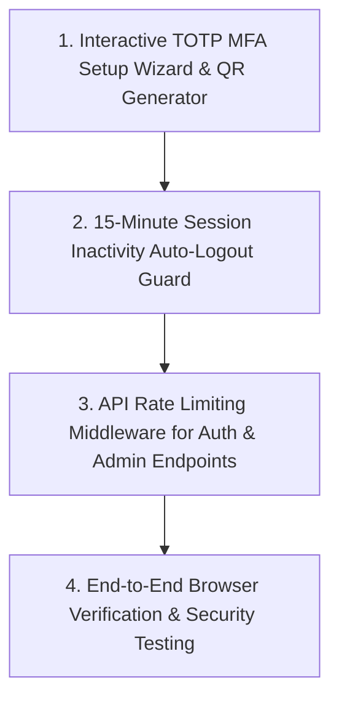

# Implementation Plan: Phase 4 Security Hardening & Session Safeguards

This document outlines the detailed build plan for **Phase 4: Security Hardening & Session Safeguards** of the **Veridica OJS Super Admin Panel**, in accordance with SRS v1.0 (NFR-5.2 & FR-3.17.9).

> [!NOTE]
> **Phases 1, 2, and 3** have been fully implemented, built, and verified live in Chrome.

---

## 🎯 Phase 4 Objectives

---

## 🛠️ Detailed Technical Scope

### **1. Interactive TOTP MFA Setup Wizard & Security Management (`/settings/mfa`)**
- **Page Location**: Create `src/app/(dashboard)/settings/mfa/page.tsx`.
- **API Endpoints**:
  - `POST /api/mfa/setup`: Generates base32 secret (`speakeasy.generateSecret()`) and Data URL QR code (`qrcode.toDataURL()`).
  - `POST /api/mfa/verify`: Validates 6-digit TOTP code (`speakeasy.totp.verify()`). Upon verification, updates `veridica_super_admins` (`mfa_enabled = 1`, `mfa_secret = secret`). Logs `super_admin_action` in audit trail.
  - `POST /api/mfa/disable`: Disables MFA (`mfa_enabled = 0`, `mfa_secret = NULL`) with current password verification.
- **UI Components**:
  - MFA Status Badge (Enabled / Disabled).
  - Step 1: Scan QR Code with Authenticator App (Google Authenticator, Authy, 1Password).
  - Step 2: Manual Secret Key fallback with one-click copy button.
  - Step 3: 6-digit TOTP code input field with "Verify & Enable MFA" button.

---

### **2. Client-Side Session Inactivity Auto-Logout Guard (NFR-5.2)**
- **Component**: Create `src/components/auth/InactivityGuard.tsx` embedded in `DashboardLayout`.
- **Behavior**:
  - Tracks user activity events (`mousemove`, `keydown`, `click`, `scroll`, `touchstart`).
  - Reset idle timer on user activity.
  - At **14 minutes** of continuous inactivity: Display a warning modal ("Session Inactive: You will be logged out in 60 seconds unless you click Continue").
  - At **15 minutes** of inactivity: Automatically invoke NextAuth `signOut({ callbackUrl: '/login?reason=inactivity' })`.

---

### **3. In-Memory API Rate Limiting Guard Middleware (NFR-5.2)**
- **Utility**: Create `src/lib/security/rateLimiter.ts`.
- **Rate Limit Windows**:
  - **Login Route** (`/api/auth/callback/credentials`): Max 5 failed attempts per 15-minute window per IP.
  - **User Actions Route** (`/api/users/[id]`): Max 30 actions per minute per IP.
  - **Export Routes** (`/api/export`, `/api/export/pdf`): Max 10 exports per minute per IP.
- **Enforcement**: Returns HTTP 429 Too Many Requests with header `Retry-After: <seconds>` if limits exceeded.

---

### **4. Navigation & Layout Updates**
- Update `Sidebar.tsx`: Add "Security & 2FA" menu item with icon (`🔐`) pointing to `/settings/mfa`.

---

## 🔍 Verification & Testing Strategy

1. **MFA Setup Test**: Test TOTP secret generation, QR Code rendering, TOTP code verification using `speakeasy`, and MFA database update.
2. **Inactivity Timer Test**: Simulate idle time in browser subagent and verify warning modal & auto-logout redirect to `/login?reason=inactivity`.
3. **Rate Limiter Test**: Send burst requests to protected API endpoints and verify HTTP 429 response when limit exceeded.
