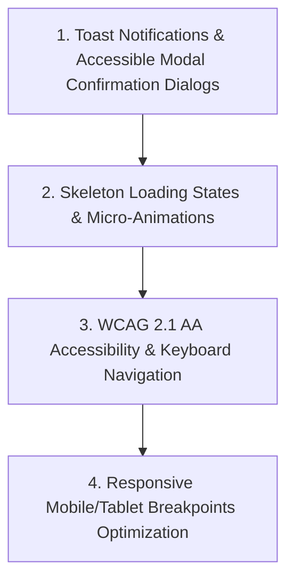

# Implementation Plan: Phase 5 Veridica UI/UX Polish & Accessibility

This document details the build plan for **Phase 5: Veridica UI/UX Polish & Accessibility** of the **Veridica OJS Super Admin Panel**, in accordance with SRS v1.0 (SRS Section 4.1, FR-3.14, NFR-5.5).

> [!NOTE]
> **Phases 1, 2, 3, and 4** have been fully built, verified, and tested live in Chrome.

---

## 🎯 Phase 5 Objectives

---

## 🛠️ Detailed Technical Scope

### **1. Accessible Modal Confirmation Dialogs & Toast Notifications**
- **Toast Notification System (`react-hot-toast`)**:
  - Integrate `react-hot-toast` across all interactive routes (`/users`, `/settings/mfa`, `/activity`, `/metrics`).
  - Display styled toast notifications for user suspensions, reinstatements, MFA setups, and file export downloads, replacing raw browser `alert()` prompts.
- **Custom Confirmation Modal Dialogs**:
  - Replace native browser `confirm()` prompts (e.g. for account suspension, soft deletion, and disabling 2FA) with accessible confirmation modal dialogs (`@radix-ui/react-dialog` or Tailwind backdrop modals).
  - Modal features: Esc key close handler, backdrop click dismiss, focused action buttons, and clear action descriptions.

---

### **2. Skeleton Loading States & UI Polish**
- **Skeleton Component Loaders**:
  - Create reusable skeleton loader components (`src/components/ui/Skeleton.tsx`) for stat cards, user directory tables, audit log rows, and analytics charts.
  - Replaces text "Loading..." with smooth animated skeleton placeholders during data fetching.
- **Micro-Animations & Visual Design**:
  - Add smooth transition animations for hover states, button clicks, and modal appearances.

---

### **3. WCAG 2.1 AA Accessibility & Keyboard Navigation (NFR-5.5)**
- **Contrast Ratios & Focus Rings**:
  - Verify minimum 4.5:1 text-to-background contrast ratio across all text elements and status badges.
  - Add visible focus ring styles (`focus:ring-2 focus:ring-[#003366] focus:ring-offset-2`) to all interactive elements for keyboard-only users.
- **Screen Reader Support (ARIA)**:
  - Add `aria-label`, `aria-expanded`, `aria-describedby`, and ARIA roles (`role="dialog"`, `role="status"`, `role="alert"`) to interactive elements and modals.

---

### **4. Mobile & Tablet Responsive Drawer**
- **Mobile Sidebar Drawer**:
  - Add responsive hamburger toggle button for screens < 768px (`md:` breakpoint).
  - Slide-over mobile navigation drawer for mobile/tablet inspection.

---

## 🔍 Verification & Testing Plan

1. **Toast & Modal Testing**: Verify styled toast messages and modal confirmation dialogs when suspending/reinstating users or modifying MFA settings.
2. **Skeleton & Animation Check**: Verify smooth skeleton loading states on initial page loads.
3. **Keyboard Navigation & Accessibility Audit**: Test tabbing through all inputs, buttons, and modals using keyboard only (`Tab`, `Enter`, `Esc`).
4. **Responsive Testing**: Test layout responsiveness in browser subagent at mobile (375px), tablet (768px), and desktop screen sizes.
